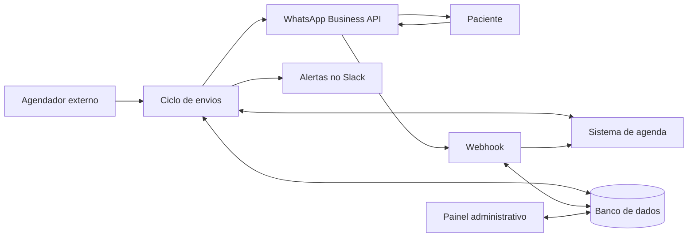

# Estudo de caso: bot de confirmação de consultas no WhatsApp

Sistema que desenvolvo e mantenho em produção em uma clínica médica. Ele confirma consultas e exames pelo WhatsApp e atualiza a agenda da clínica com a resposta do paciente.

> O código é privado porque o sistema lida com dados de pacientes. Este repositório mostra o problema, a arquitetura e as decisões técnicas, sem dados da clínica ou de pacientes.

## O problema

A recepção confirmava os agendamentos por telefone, um a um. Isso tomava tempo da equipe, e cada resposta ainda precisava ser lançada à mão na agenda.

## Resultado

- O bot envia milhares de confirmações por mês.
- Cerca de 94% dos agendamentos terminam confirmados ou cancelados. Esse número inclui confirmações que a recepção lança direto na agenda, porque o bot também sincroniza esses casos.

## Tecnologias

Node.js, Express, Meta WhatsApp Business API, PostgreSQL (Supabase), Slack, Railway e, no painel administrativo, Next.js com TypeScript.

## Arquitetura

**Envio:** a cada ciclo, o bot busca os agendamentos elegíveis, consulta o que já foi enviado e dispara as confirmações, os lembretes e os avisos.

**Resposta:** o webhook valida a assinatura da Meta, ignora eventos repetidos, atualiza a agenda e responde ao paciente.

## Decisões técnicas

### Identificador que se repete

A agenda reaproveita o mesmo ID de atendimento em agendamentos diferentes. Por isso, toda verificação de duplicidade e toda exclusão usam o ID junto com a data. Usar só o ID causava mensagens repetidas e apagava registros atuais.

### Janela de 24 horas da Meta

Fora da janela de atendimento, a Meta só aceita templates aprovados. O bot trabalha com uma margem de 23 horas: dentro dela envia texto livre e, fora dela, usa um template.

### Falhas sem perda de resposta

- **Agenda indisponível:** um circuit breaker e um limite de chamadas simultâneas evitam sobrecarregar a API.
- **Atualização que falha:** a operação entra em uma fila e é repetida depois.
- **Erro temporário da Meta:** o envio é tentado de novo no ciclo seguinte. Erros de número ou de template não são repetidos e geram um alerta.

### Cancelamento em lote

Um paciente pode ter vários procedimentos no mesmo dia, e o mesmo número pode atender mais de uma pessoa. Confirmações e cancelamentos valem para todo o conjunto de número e data, com uma etapa extra antes de cancelar.

### Respeito ao paciente

O bot não envia mensagens no horário de silêncio, em feriados ou em datas bloqueadas. Números sem WhatsApp saem da fila daquele agendamento, para não gerar novas tentativas.

### Segurança do webhook

As requisições são verificadas por HMAC, e o webhook recusa as que não puder validar. Eventos repetidos são descartados.

## O que veio depois

O sistema cresceu conforme a rotina da clínica pediu, e hoje também tem:

- Transferência de agenda em lote, com aviso ao paciente.
- Lista de espera automática, que oferece horários vagos.
- Avisos antecipados e envio de preparo de exame.
- Painel administrativo com histórico e métricas.

## Autor

**Yuri Dorigon** — [Portfólio](https://yuri-dorigon.vercel.app) · [LinkedIn](https://www.linkedin.com/in/yuridorigon)
